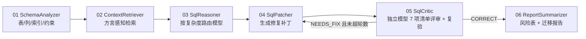
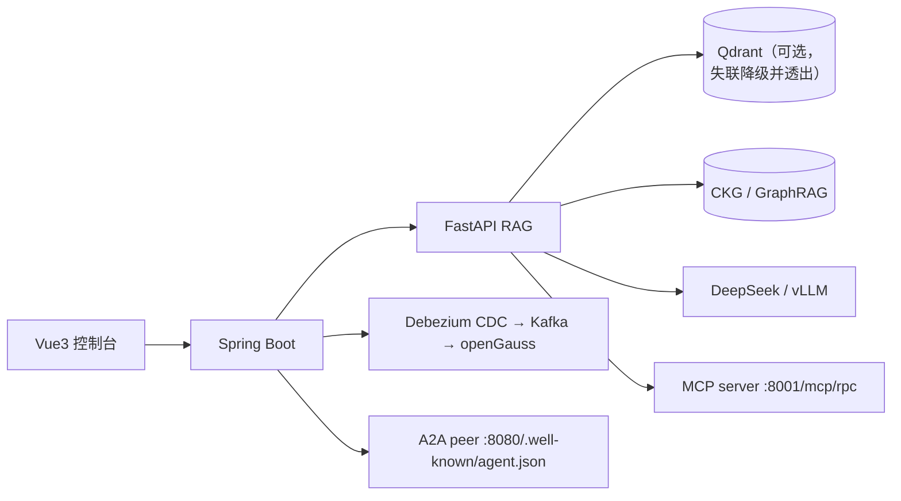

# 智迁云枢 ZhiQian YunShu v2.0 🚀

> **LLM Agent + 知识图谱驱动的跨方言数据库迁移智体**
>
> MySQL / Oracle / SQLServer → openGauss / PostgreSQL，六 Agent 可解释流水线，评测驱动，生态互联。

[]() []() []() []() []() []()

## 核心亮点

- **六 Agent 可解释迁移流水线**：`SchemaAnalyzer → ContextRetriever → SqlReasoner → SqlPatcher → SqlCritic → ReportSummarizer`，LangGraph 风格自实现状态机 + critic→patcher 反思回环；终态三分为 `DONE / FAILED / REVIEW_REQUIRED`——复验不过不谎报成功。每步 SSE 步进事件 + Langfuse 全链 trace。
- **CRAG + GraphRAG 双增强检索**：BGE-M3 稠密 / BM25 / 稀疏三路 RRF 融合 + 可选重排；CRAG 对检索质量本身做评估与纠正，GraphRAG（轻量 CKG）补跨文档结构关系；方言感知过滤（方向不符的文档直接零分）。七种显式 retrieval mode 支撑消融对照。
- **MCP + A2A 生态互联**：RAG 侧 MCP server（JSON-RPC 2.0，`/mcp/rpc`）可被 Claude Desktop / Cursor 直接调用；backend 侧 A2A peer（AgentCard + tasks SSE）可与其他 Agent 互操作。
- **评测方法论完整性（差异化）**：客观指标先行（sqlglot AST 级 SQL 等价、排序敏感的 MRR@10）；LLM judge 须经 Cohen's κ 校准 + 按「judge 真正改变结论的边界样本」分层抽样；判别力统计、A/A 噪声地板、金标质量分层——先证明「指标测得准」，再谈数字。见 [eval/README.md](eval/README.md) §五「指标为什么会说谎」。

本项目同时是一份**垂直领域 Agent 参考实现**：领域知识三层模型（KB 文档 / 转换配方 / 特征触发器）、失败学习闭环（评测失败 → LLM 生成知识 → 人工门禁 → 回注验证）。完整方法论见 [docs/AGENT_DESIGN.md](docs/AGENT_DESIGN.md)（推荐首读）。

## 架构总览

三服务拓扑：

| 服务 | 技术栈 | 端口 |
| --- | --- | --- |
| web 控制台 | Vue 3.4 · Vite 5 · Element Plus · Pinia · ECharts | 5173 |
| backend | Spring Boot 3.2.5 · Spring Security · OpenAPI | 8080 |
| rag | Python 3.11 · FastAPI · BGE-M3 · Qdrant · sqlglot | 8001 |

六 Agent 流水线（唯一执行图，任务执行与 `/migrate` 共用，出处 [docs/AGENT_DESIGN.md](docs/AGENT_DESIGN.md) §2）：





详架构看 [docs/architecture/00-overall.md](docs/architecture/00-overall.md) 与 `zhiqian/docs/architecture/`。

## 快速开始

环境要求：**Java 17+**（pom 以 17 为基准，实测 21 LTS）· **Python 3.11–3.12** · **Node 20+ / pnpm** · Docker（可选，用于公开数据集）；GPU 可选（本地跑 BGE-M3 / 重排更快，CPU 可运行）。

```bash
# 1) 克隆
git clone https://github.com/anothersunset/zhixianyunshu.git
cd zhixianyunshu

# 2) 一键 demo（拉起 MySQL 5.7 + openGauss 数据集，再启动 RAG / backend / web）
make demo            # 等同 bash scripts/demo-walkthrough.sh

# 3) 打开控制台
open http://localhost:5173    # admin / admin123
```

手动三服务（熟手，`make help` 看全量命令）：

```bash
make backend         # cd zhiqian/backend && ./mvnw spring-boot:run   (8080)
make rag             # cd zhiqian/rag && uvicorn app.main:app --reload (8001)
make web             # cd zhiqian/web && pnpm dev                      (5173)
```

> **离线也能跑，但要知道自己在看什么**：`LLM_API_KEY` 留空时 backend 走确定性降级（MockLlmClient 占位回显，不调真实 LLM）；RAG 失联时检索降级本地 mock——两者都会在 trace 与降级轨迹里如实标记。真实迁移质量需在 `zhiqian/deploy/.env` 配置 LLM / Qdrant 凭据后验证。

演示路径：登录 → 选项目 → 走一次 MySQL→openGauss SQL 转换（看六 Agent 流水 trace）→ 下载 Typst PDF 报告（含风险表）→ 暗色主题 + 英文切换 → `/present` 幻灯演示模式 → `/edge` 端侧小模型（需下约 600MB）→ 用 Claude Desktop 连 `http://localhost:8001/mcp/rpc` 调 MCP 工具。

## 评测口径（每个数字有出处）

| 数字 | 口径 | 出处 |
| --- | --- | --- |
| Oracle→PostgreSQL **30/30** | fast mode，`oracle_pg.jsonl` 30 case，v12 规则扫描器（统一注册表 + 两阶段检测，零回归） | [规则扫描器 devlog](eval/docs/devlog-2026-06-24-rule-scanner-architecture.md) |
| SQL Server **32/32 (100.0%)** | fast mode | [SQLServer 支持 devlog](docs/devlog-2026-06-30-sqlserver-support.md) |
| 失败学习闭环 **38/38** | 失败 case×mode 组合回注 KB 后全部改善（100%） | [失败学习闭环 devlog](docs/devlog-2026-06-24-failure-learning-loop.md) |
| PARROT 子集 **35% → 80%**（调整口径 90%） | 84 个含真实 Oracle 特征 case 中取 20 测试；80% 为三层复审后原始率，90% 为排除 10 个含 Oracle 残留可疑金标后的调整率 | [三层复审体系 devlog](eval/docs/devlog-2026-06-24-review-system.md) |
| 消融最优 **Vector+Rerank**：SQL 修复率 98.8% | 旧口径五档消融（同数据集）；注意 A→E 不单调——Full 引入图噪声低于 Vector+Rerank | [消融实验 devlog](eval/docs/devlog-2026-06-10-ablation-experiments.md) |
| CRAG/Full Recall@5 **0.30 → 0.73** | reranker OOM 修复前后（+143%） | [RAG 稳定性 devlog](eval/docs/devlog-2026-06-13-reranker-rag-stability.md) |
| 真实全栈五数据集 **96.6%**（112/116） | glm-4-flash（免费档）+ 真 BGE-M3 + 真 reranker 全链路无 mock：oracle 30/30、mysql 60/60（og+pg）、sqlserver 29/32；零系统错误零 mock，provenance 全记录 | [真实全栈评测 devlog](eval/docs/devlog-2026-10-10-real-stack-eval.md) |
| 真实五组消融：**Vector+Rerank 最优 90.0%**；CRAG 76.7%、GraphRAG 66.7% | 显式 retrieval mode 门控下的 oracle→pg × 30 per-case 对照（150 次真实调用）；CRAG/GraphRAG 提升召回（E 组 Recall@5 0.9375 最高）但降低转译修复率——适用于解释/问答场景而非转译 | [真实全栈评测 devlog](eval/docs/devlog-2026-10-10-real-stack-eval.md) §3 |

> **边界声明（先于一切数字）**
>
> 1. **CRAG / GraphRAG 的语义增益已由真实对照收口（2026-10-10）**：显式模式门控 + trace 验证下的五组对照显示，二者提升检索召回但**不提升 SQL 转译修复率**（C 90.0% → D 76.7% → E 66.7%）；转译最优配置为 Vector+Rerank，CRAG/GraphRAG 的价值定位在开放域问答与解释场景（/crag/query、/graphrag/* 端点）。旧口径的 CRAG/Full 消融数字（如 82.14%）已作废不再引用；E 组下降的根因归因（图权重/prompt 预算）见 devlog §5 遗留。
> 2. **CI 默认验收完全离线**：Java 走 `mvn clean verify`（含核心包 70% JaCoCo 行覆盖门禁），RAG 与 eval 走确定性 pytest，前端走类型检查 + 生产构建。真实 Qdrant、外部 LLM 与 Langfuse 属于凭据齐备后的可选 smoke；未配置时只验证显式降级、过滤器构造和追溯契约，**不把 mock 或启发式结果报告为在线质量成绩**。
> 3. Demo seed 中的 confidence / 综合分仅用于 UI 与报告流程演示，真实效果以独立评测集与人工复核为准。
> 4. 2026-10-10 真实评测的口径边界：LLM 与 judge 均为 glm-4-flash 免费档（judge 未做人工 κ 校准，每数据集仅裁决 1-3 例）、BGE-M3 为本机 CPU fp32——与 6 月 deepseek-chat 口径的数字不可直接混比，结果文件带完整 provenance。

## 工程质量

测试现状（2026-10-09 于分支 `codex/p0-p1-repair` 工作树本地复跑，四套件全绿）：

| 套件 | 结果 |
| --- | --- |
| backend `mvn clean verify` | **103 tests, 0 failures, 1 skipped**；JaCoCo 核心迁移运行时包行覆盖约 79%（门禁 ≥70%，只圈 agent/task/security/auth/project/report/a2a/common + 3 个迁移类，legacy 与适配器不稀释信号） |
| RAG `pytest` | **64 passed, 3 skipped** |
| eval 指标自检 `pytest eval/tests` | **33 passed**（HEAD 口径 31 + 本轮新增 noise_floor 2 例） |
| web `npm run build` | vue-tsc 类型检查 + vite 生产构建通过 |

安全与修复轮次（全部 devlog 留痕）：

| 轮次 | 范围 | 出处 |
| --- | --- | --- |
| v1.0.1–v1.0.4 hotfix | 演示脚本 / 模板插值 / CI 工作流 / 容器健康检查 | [CHANGELOG](CHANGELOG.md) |
| 2026-07-09 第一轮 P0/P1 | 外部审查 10 项逐条对照真实代码核实（3 处描述有出入）后修复：critic 谎报、CORS、Dockerfile 非 root 等 | [devlog](docs/devlog-2026-07-09-p0-p1-audit.md) |
| 2026-07-10~12 第二轮加固（15 commit） | 六 Agent 链路统一、Bearer Header + owner 鉴权 + 409/429、MCP/A2A 契约、显式 retrieval mode、70% 覆盖率门禁、uv.lock 依赖冻结 | [devlog](docs/devlog-2026-07-12-second-hardening-round.md) |
| 2026-09~10 第三轮（10 commit） | 方言契约 / 任务对账 / 降级诚实化 / Qdrant 可见性 / 前端体验 / 部署文档 | [CHANGELOG Unreleased](CHANGELOG.md) |

CI：`.github/workflows/ci.yml`（`mvn verify` + `uv sync --frozen` + 前端构建）与 `supply-chain.yml`（Syft SBOM · Trivy · Cosign keyless）。

## 目录结构

```
zhixianyunshu/
├── README.md / CHANGELOG.md / UPGRADE_PLAN.md
├── Makefile / start-local.sh / VERSION
├── docs/                  方法论（AGENT_DESIGN）· 架构图 · 对比 · devlog（审计/加固/SQLServer/失败闭环）
├── eval/                  评测驱动开发：run_eval / ablation / judge / noise_floor / 失败学习闭环 / datasets
├── kb/                    领域知识库单一真源（active / pending / backups / deploy_log）
├── scripts/               demo-walkthrough / healthcheck / smoke-test / 供应链工作流安装
└── zhiqian/
    ├── backend/           Spring Boot 3.2.5 主服务（8080）
    ├── rag/               Python 3.11 FastAPI RAG（8001）
    ├── web/               Vue 3.4 + Element Plus 控制台（5173）
    ├── deploy/            Kustomize / ArgoCD / KubeRay / Debezium CDC / 公开数据集
    ├── docs/              架构详解（agent-pipeline / rag-retrieval）
    └── security/          供应链策略 + workflow 模板
```

## 文档导航

- [docs/AGENT_DESIGN.md](docs/AGENT_DESIGN.md) — 垂直领域 Agent 五支柱方法论（推荐首读）
- [docs/INDEX.md](docs/INDEX.md) — 文档总索引
- [eval/README.md](eval/README.md) — 评测体系与「指标为什么会说谎」五陷阱
- [eval/docs/devlog-index.md](eval/docs/devlog-index.md) — 全部开发日志索引（问题 → 方案 → 验证 → 教训）
- [zhiqian/deploy/README.md](zhiqian/deploy/README.md) — K8s / GitOps 部署
- [CHANGELOG.md](CHANGELOG.md) · [UPGRADE_PLAN.md](UPGRADE_PLAN.md) — 提交史与决策史
- [zhiqian/docs/comparison.md](zhiqian/docs/comparison.md) — 与 AWS DMS / Alibaba DTS / Ora2Pg / pgloader / DataX / RAGFlow / Verba 的 6 维对比

## 许可与致谢

Apache License 2.0。致谢 DeepSeek · BGE · sqlglot · Debezium · openGauss · Typst · transformers.js · Anchore · Aqua · Sigstore。
